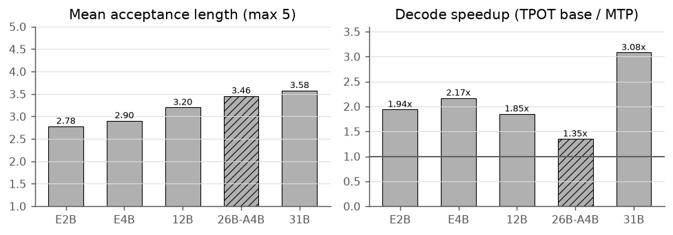
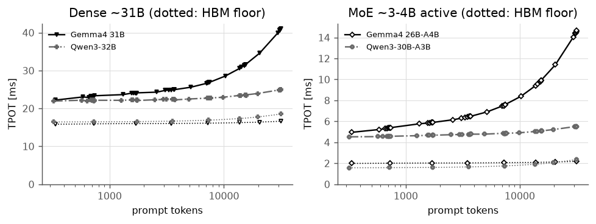
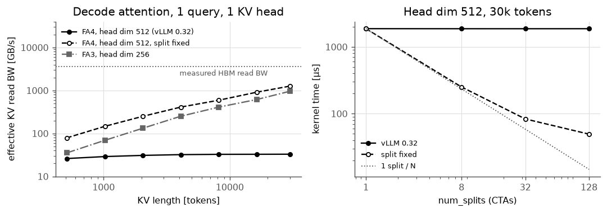
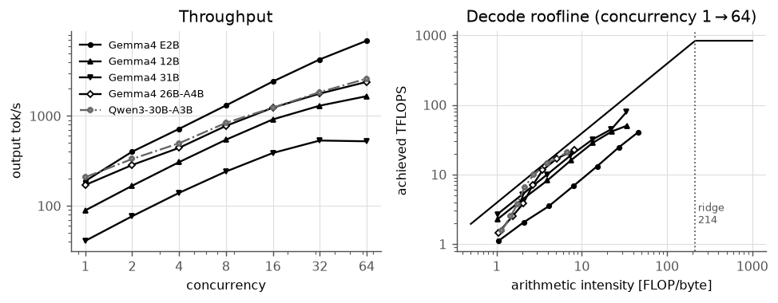

# Gemma 4 のサービング性能評価（H100 NVL 1 基 / vLLM 0.32）

Gemma 4 ファミリ（E2B, E4B, 12B, 26B-A4B MoE, 31B Dense）を NVIDIA H100 NVL 1 基上の vLLM 0.32.0 で
OpenAI 互換サーバとして動かし，TTFT・TPOT・同時実行時のスループット・公式 MTP Drafter による speculative decoding の効果を測定しました。
比較対象は Qwen3-30B-A3B と Qwen3-32B です。測定値はチェックポイントから計算した roofline 上の理論限界と突き合わせています。

**📄 レポート本体（39 ページ，日本語）: [`report/main.pdf`](report/main.pdf)**

## 要旨

- 大きい dense モデル（31B）の decode は HBM 理論帯域の **70%** に達し，MTP Drafter で最大 **3.1–3.3 倍**速くなる。
- 長いコンテキストの decode は vLLM 0.32.0 では Qwen3 より遅い。原因は **FlashAttention-4 カーネルの split-KV のバグ**（128 個の CTA のうち 1 個しか働かない）で，
  1 行の修正で 30k トークンでの TPOT は最大 **4.6 倍**速くなり，Qwen3 を上回る（修正は vLLM v0.32.1rc0 以降に入っている）。
- 一方，高並列での KV キャッシュ容量とスループットでは，Hybrid Attention のアーキテクチャ上の利点を現状の vLLM が活かしきれていない。

## 主な結果

実測サマリ（レポート表 9）。TTFT は約 1k / 32k トークンのプロンプト [ms]，TPOT は短いコンテキスト・同時実行 1 [ms]，
TPOT<sub>min</sub> は重みと KV を理論 HBM 帯域で読む下限，MTP は同時実行 1 での高速化と平均 acceptance length (AL)。

| Model | TTFT 1k | TTFT 32k | prefill MFU | TPOT | TPOT<sub>min</sub> | HBM util. | MTP speedup | AL | max out tok/s |
|---|--:|--:|--:|--:|--:|--:|--:|--:|--:|
| Gemma 4 E2B | 22 | 602 | 36% | 4.21 | 1.19 | 28% | 1.94× | 2.78 | 6869 |
| Gemma 4 E4B | 25 | 896 | 43% | 6.23 | 2.42 | 39% | 2.17× | 2.90 | 4264 |
| Gemma 4 12B | 42 | 2203 | 47% | 10.41 | 6.19 | 59% | 1.85× | 3.20 | 1659 |
| Gemma 4 26B-A4B | 35 | 1051 | 33% | 5.30 | 2.00 | 38% | 1.35× | 3.46 | 2392 |
| Gemma 4 31B | 104 | 5999 | 45% | 22.87 | 15.91 | 70% | 3.08× | 3.58 | 533 |
| Qwen3-30B-A3B | 45 | 1563 | 41% | 4.56 | 1.58 | 35% | – | – | 2599 |
| Qwen3-32B | 106 | 7179 | 49% | 22.01 | 16.45 | 75% | – | – | 839 |

### Qwen3 と比べてどうか（レポート表 18）

| 観点 | 評価 | 根拠 |
|---|:-:|---|
| 長いプロンプトの TTFT | ○ | 32k で 16–33% 短い（Hybrid Attention） |
| 単一ストリームの decode（短いコンテキスト） | △ | ほぼパラメータ数どおり |
| MTP を使った単一ストリームの decode | ○ | 31B は Qwen3-32B（baseline）の約 3 倍速い |
| 長いコンテキストの decode | × → 修正後 ○ | v0.32.0 では 30k で TPOT の増分 9–18 ms（Qwen3 は 1–3 ms）。split-KV 修正後は 31B 23.3 対 24.9 ms |
| 長いコンテキストの KV 量（理論） | ○ | 32k で 31B 3.3 GiB 対 Qwen3-32B 8.0 GiB |
| 短いリクエストの高並列スループット | × | 64 並列で 31B は Qwen3-32B の 0.6 倍。FP8 KV でも変わらない |
| MoE の高負荷スループット | △ | 2,392 対 2,599 tok/s |

### 用途別の推奨

- **低負荷・低 latency の対話**: 31B + MTP（γ=4–8）が最速。Qwen3-32B の約 3 倍の速さで出力できる。
- **長いプロンプトを読ませる用途**（RAG・要約など）: prefill が速く，split-KV 修正後は decode も速い Gemma 4 が有利。vLLM **v0.32.1rc0 以降**を使う。
- **短いリクエストを大量にさばく用途**: スループット重視なら Qwen3-32B が有利。FP8 KV キャッシュは TTFT（18 s → 4.4 s）の改善には有効。

### 図の例

| MTP の高速化（図 26） | 長いコンテキストの decode（図 19） |
|---|---|
|  |  |
| **FA4 split-KV の修正前後（図 21）** | **同時実行数スケーリング（図 22）** |
|  |  |

全図は [`report/figures/`](report/figures/) にあります（PDF と PNG）。

## 実験環境

| 項目 | 値 |
|---|---|
| GPU | NVIDIA H100 NVL（94 GB HBM3，132 SM，TDP 400 W） |
| 理論値 | HBM 3.9 TB/s，BF16 Tensor Core 835 TFLOPS（dense） |
| 実測（マイクロベンチ） | HBM 3.57–3.58 TB/s，BF16 GEMM 492–514 TFLOPS |
| CPU / RAM | AMD EPYC 9V84（40 vCPU）/ 314 GiB |
| ソフトウェア | Driver 595.91.07，CUDA 13.2，PyTorch 2.13.0+cu130，vLLM 0.32.0，Transformers 5.19 |

## 再現手順

### 環境構築

```bash
uv sync                      # vLLM 0.32.0 / PyTorch 2.13.0 (CUDA 13.0) / Transformers 5.19.0
source .venv/bin/activate
hf auth login                # google/gemma-4-* はライセンスへの同意が必要
```

`uv.lock` は Linux x86_64・Python 3.11 向けです。計測時の環境から numpy だけ 2.4.6 → 2.3.5 になっています（vLLM 0.32.0 の依存制約のため。計測結果には影響しません）。

理論値の計算（`theory.py`）と図の生成（`analyze.py`）は Hugging Face キャッシュ（`~/.cache/huggingface/hub`）にある
チェックポイントの safetensors ヘッダと `config.json` を読むので，先に E1 を実行するか `hf download <model>` でダウンロードしておいてください。

### 実験とレポートの対応

実験番号はレポートの表 7「実験の一覧」と同じです。

| 番号 | 実験 | 実行するもの | 出力 | レポート |
|---|---|---|---|---|
| 準備 | ワークロード作成 | `scripts/prepare_workloads.py` | `data/workloads.json`（同梱なし） | §7 表 8 |
| T | 理論値 | `scripts/theory.py` | `data/theory.json` | §6 表 6, 図 12 |
| E1 | 単一ストリーム | `scripts/serve_bench.py`（`latency` スイート） | `data/serve/<tag>.json` | §8.1–8.3 |
| E2 | 同時実行数スイープ | `scripts/serve_bench.py`（`concurrency` スイート） | `data/serve/<tag>.json` | §8.5 |
| E3 | speculative decoding | `scripts/serve_bench.py --spec-method mtp/ngram` | `data/serve/<tag>_mtp<γ>.json` | §8.6 |
| E4 | KV 容量 | E1/E2 のサーバログ `logs/server_<tag>.log` を `analyze.py` が集計 | `data/kv_capacity.json` | §8.5 表 15 |
| E5 | マイクロベンチ | `scripts/microbench.py` | `data/microbench.json` | §4 表 2 |
| E6 | Nsight Systems | `scripts/profile_decode.py` + `scripts/analyze_nsys.py` | `data/nsys/<tag>.json` | §8.2–8.3, §8.6 |
| E7 | Nsight Compute | `scripts/run_ncu.sh` | `data/ncu/E2B_attn_ctx32k.csv` | §8.3 表 13 |
| E8 | 追加計測（backend・FP8 KV・再現性） | `scripts/run_remeasure.sh` | `data/remeasure/` | §4, §8.3, §8.5, §8.6 |
| E9 | カーネル解析と split-KV 修正版での再計測 | `scripts/run_fa4fix.sh` | `data/kernel/`, `data/fa4fix/` | §8.2–8.4 |
| 図表 | 集計 | `scripts/analyze.py` | `report/figures/*`, `report/tables/*.tex` | 全図表 |

まとめて実行する場合（完了済みの構成は飛ばします）:

```bash
python scripts/prepare_workloads.py   # run_*.sh は data/workloads.json がなければ自動で実行する
scripts/run_serve_matrix.sh     # E1–E4: 全モデル × {baseline, MTP γ=1,2,4,8, n-gram}
scripts/run_profiles.sh         # E5, E6
scripts/run_ncu.sh              # E7（sudo が必要，約 20 分）
scripts/run_remeasure.sh        # E8
scripts/run_fa4fix.sh           # E9
python scripts/theory.py        # T
python scripts/analyze.py       # 図表
```

単体での実行例:

```bash
# 準備: serve_bench.py は data/workloads.json を読むので先に作る（GPU 不要）
python scripts/prepare_workloads.py

# E1・E2: vllm serve を起動し，ストリーミングでクライアント側の TTFT / TPOT を測る
python scripts/serve_bench.py --tag E2B --model google/gemma-4-E2B-it
python scripts/serve_bench.py --tag 31B --model google/gemma-4-31B-it \
    --max-model-len 34816 --gpu-mem-util 0.95

# E3: MTP Drafter（--num-spec が draft length γ）
python scripts/serve_bench.py --tag E2B_mtp4 --model google/gemma-4-E2B-it \
    --spec-method mtp --draft-model google/gemma-4-E2B-it-assistant --num-spec 4

# E6: decode 区間だけを Nsight Systems で記録して分類・集計
nsys profile -f true -o logs/nsys/E2B_b1 -t cuda,nvtx --cuda-graph-trace=node \
    --capture-range=cudaProfilerApi --capture-range-end=stop \
    python scripts/profile_decode.py --model google/gemma-4-E2B-it --batch 1
nsys export -f true --type sqlite -o logs/nsys/E2B_b1.sqlite logs/nsys/E2B_b1.nsys-rep
python scripts/analyze_nsys.py logs/nsys/E2B_b1.sqlite data/nsys/E2B_b1.json
```

tag の命名（`<model>`, `<model>_mtp<γ>`, `<model>_ngram<γ>`）は `analyze.py` が baseline と speculative decoding の組を作るのに使うので変えないでください。

### FA4 split-KV の修正

vLLM 0.32.0 同梱の FlashAttention-4（SM90）では split-KV の分割数がカーネルに渡っていません。
修正は [`patches/fa4_sm90_splitkv.patch`](patches/fa4_sm90_splitkv.patch) と，パッケージを書き換えずに実行時に当てる
[`scripts/fa4fix/`](scripts/fa4fix/)（`PYTHONPATH=scripts/fa4fix GEMMA4_FA4_FIX=1` で `sitecustomize.py` 経由で有効化）にあります。上流の flash-attention / vLLM main では修正済みです。

### レポートのビルド

ビルドに必要なもの（本文・概念図・表・グラフ）はすべて `report/` の中にあり，`data/` や GPU がなくてもビルドできます。

```bash
cd report && latexmk -lualatex main.tex
```

計測データから図表を作り直す場合は，先に `python scripts/analyze.py` を実行すると `report/figures/` と `report/tables/` が上書きされます。

図はモノクロ印刷向けで，モデルはマーカーの形，dense/MoE は塗り/白抜き，Gemma 4/Qwen3 は実線/一点鎖線で区別しています。
概念図（`report/diagrams/*.tex`）は TikZ/pgfplots で書かれ，ビルド時に描画されます。

### 動作確認

2026 年 10 月 29 日に，このリポジトリを新しく clone して `uv sync` から上の手順どおりに実行し，同梱のデータと比べました（計測と同じ H100 NVL 1 基）。
時間の都合で，E1–E3 は E2B・同時実行 1 と 8 に絞っています。

| 手順 | 結果（再実行 / 同梱データ） |
|---|---|
| 準備 `prepare_workloads.py` | `data/workloads.json` がバイト単位で一致 |
| T `theory.py` | `data/theory.json` がバイト単位で一致 |
| 図表 `analyze.py` | `report/tables/*.tex` がすべて一致（図の PDF は作成日時のみ異なる） |
| レポートのビルド | 39 ページの PDF が生成される |
| E5 `microbench.py` | HBM 3.59 / 3.57 TB/s，BF16 GEMM 484 / 492 TFLOPS（電力制限による揺れの範囲内） |
| E1/E2 `serve_bench.py`（E2B） | TPOT 4.40 / 4.40 ms（同時実行 1），5.66 / 5.72 ms（同時実行 8） |
| E3 `serve_bench.py`（E2B，MTP γ=4） | TPOT 2.16 / 2.20 ms（同時実行 1），3.24 / 3.17 ms（同時実行 8） |
| E6 Nsight Systems（E2B，バッチ 1） | カーネル数 149,747 / 149,747，GPU busy 89.5 / 89.8% |
| E7 `run_ncu.sh` | global 層の FA4 カーネル 2.76 / 2.78 ms，グリッド 128 CTA，DRAM 利用率 0.58 / 0.58% |
| E9 `attn_bench.py`（head dim 512，16k トークン） | 修正前 1024 / 1025 µs，修正後 36.8 / 36.8 µs |
| `run_*.sh` | `data/workloads.json` がなければ自動で作成し，結果のある構成は飛ばして完走 |

既知の注意点：`run_remeasure.sh` の `E2B_fp8kv` は，E2B が FP8 KV キャッシュでは CUDA Graph の取り込み中にエラーで起動しないため，実行するたびに `FAIL` と表示されます。結果ファイルが作られないので毎回再試行されるだけで，他の構成には影響しません。

## ディレクトリ構成

```
report/        LaTeX ソースとビルド済み PDF（main.pdf）。ビルドに必要なものはすべてここにある
  figures/     analyze.py が生成する全グラフ（PDF / PNG）
  tables/      analyze.py が生成する表
  diagrams/    概念図（TikZ）
  code/        レポートのコード 1–7（vLLM 0.32.0 の gemma4 関連実装からの抜粋，`# <-` 以降は筆者注）
scripts/       計測・プロファイル・集計スクリプト
patches/       FA4 split-KV の修正パッチ
data/          計測結果（下記）
```

### `data/` に同梱しているもの

H100 NVL 上で計測した結果だけを入れています。再計測には GPU で数時間〜十数時間かかり，環境が変わると同じ値にはならないためです。
これらがあれば GPU なしで `python scripts/analyze.py` を実行し，レポートの図表を作り直せます（チェックポイントのダウンロードは必要，[環境構築](#環境構築)参照）。

| パス | 内容 | 生成元 |
|---|---|---|
| `data/serve/<tag>.json` | 単一ストリーム・同時実行数スイープ・MTP / n-gram の計測結果（リクエストごとの TTFT, TPOT, AL など） | E1–E3 `serve_bench.py` |
| `data/nsys/<tag>.json` | decode 1 ステップのカーネル分類別の時間と GPU idle 率 | E6 `analyze_nsys.py` |
| `data/microbench.json` | BF16 GEMM ピークと HBM 帯域の実測値 | E5 `microbench.py` |
| `data/remeasure/` | Attention backend・FP8 KV・MTP 再現性・マイクロベンチ 3 回分の追加計測 | E8 `run_remeasure.sh` |
| `data/kernel/` | Attention カーネル（FA3 / FA4 / 修正版 FA4）と M=1 GEMM の単体ベンチ | E9 `run_fa4fix.sh` |
| `data/fa4fix/` | split-KV 修正版 FA4 での serving と Nsight Systems の再計測 | E9 `run_fa4fix.sh` |
| `data/kv_capacity.json` | vLLM がサーバ起動時に報告した KV プールの大きさと最大同時実行数 | E4 `analyze.py`（サーバログから集計） |
| `data/ncu/E2B_attn_ctx32k.csv` | 長いコンテキストでの FA4 カーネルのハードウェアカウンタ | E7 `run_ncu.sh` |
| `data/theory.json` | チェックポイントから計算した層ごとのバイト数・FLOPs・KV 量 | T `theory.py` |

次のファイルはすぐ作り直せるため同梱していません（`.gitignore` 済み）。

| ファイル | 作り方 |
|---|---|
| `data/workloads.json` | `python scripts/prepare_workloads.py`（GPU 不要。乱数を使わないので毎回同じものができる。Babilong / SWE-bench Lite の本文を含むため再配布していない） |
| `data/mtp_summary.csv`, `data/spec_cost_model.csv` | `python scripts/analyze.py` の出力 |

スクリプトが実行時に書き出す `logs/`（vLLM のサーバログ，Nsight Systems / Compute の生データ `*.nsys-rep`, `*.ncu-rep`, `*.sqlite`）も含めていません。
図表に使う値はすべて上の `data/` に集計済みなので，`logs/` がなくても `analyze.py` とレポートのビルドは動きます。
